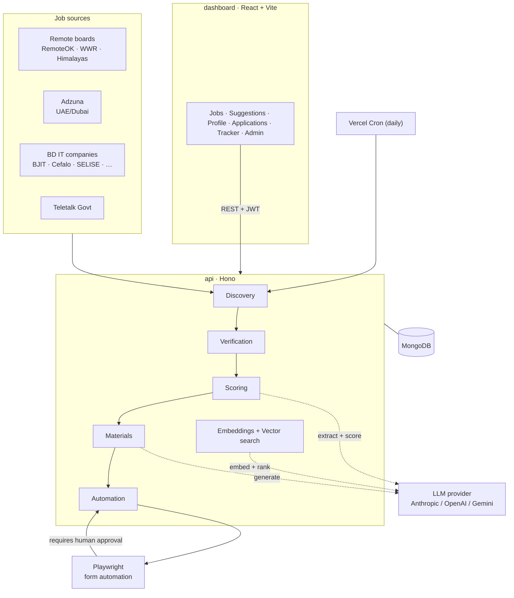

<div align="center">

# 🛰️ TalentRadar

**An AI-assisted job–hunting platform that discovers, verifies, scores, matches, and helps you apply to jobs — with a human in the loop at every irreversible step.**


</div>

---

TalentRadar crawls many job boards and company career pages, de-duplicates and verifies that each posting is still live, uses an LLM to score how well each role fits **your** profile, surfaces semantic "best match" suggestions from your résumé, generates ATS-optimized application materials, and can even drive a browser to pre-fill application forms — **always stopping for your approval before anything is submitted.**

## 📑 Table of contents

- [Features](#-features)
- [How it works](#-how-it-works)
- [Architecture](#-architecture)
- [Getting started](#-getting-started)
- [Configuration](#-configuration)
- [API reference](#-api-reference)
- [Data model](#-data-model)
- [AI & embeddings](#-ai--embeddings)
- [Deployment](#-deployment)
- [Security](#-security)
- [Documentation](#-documentation)

---

## ✨ Features

### Discovery & curation
- **Multi-source discovery** — pulls from remote boards (**RemoteOK**, **We Work Remotely**, **Himalayas**), an aggregator (**Adzuna** — UAE/Dubai tech), **9 Bangladesh IT company career pages** (BJIT, Brain Station 23, Cefalo, DS Innovators, Enosis, Riseup Labs, SELISE, Vivasoft, Bdtask), and **Bangladesh government jobs** (Teletalk). Each source fetches politely with per-host rate limiting; unconfigured sources (e.g. Adzuna without keys) are skipped.
- **Smart de-duplication** — collapses the same job seen across sources by job ID, normalized URL, and company + title within a 60-day window.
- **Liveness verification** — re-fetches each posting and classifies it `verified` / `rejected` / `inconclusive` from HTTP status + evidence patterns ("apply now" vs. "no longer accepting applications").

### Matching & scoring
- **Deterministic fit scoring (0–100)** — an LLM extracts structured requirements, then a transparent calculator scores five capped factors: work-authorization (30), remote (20), salary (20), skills (20), location (10).
- **Semantic suggestions** — a personalized "best match" feed ranked by vector similarity between your résumé and each job, blended with the rule-based score (hybrid **0.6 / 0.4**), plus a `sort=match` option on the main jobs feed.
- **Flexible embeddings** — OpenAI (`text-embedding-3-small`, 1536-dim) **or** a free, API-key-free local model via `@huggingface/transformers` (`Xenova/all-MiniLM-L6-v2`, 384-dim) running in-process. Vector search uses **MongoDB Atlas `$vectorSearch`** with a transparent **in-memory cosine fallback** for non-Atlas setups.

### Applications
- **ATS-optimized materials** — a tailored, single-column, machine-readable **CV** plus **cover letter** and **outreach message**. The generator enforces keyword coverage of the posting, quantified bullets (≥75% target) and varied action verbs — regenerating once and keeping the stronger draft. Gaps surface as *unmet requirements* rather than fabricated experience.
- **Human-tone writing** — cover letters and outreach are prompted to read like a real person (varied rhythm, contractions) and to avoid AI/corporate clichés.
- **Markdown-aware exports** — export any document to **PDF** or **DOCX** with styled headings, bullets, bold, and clickable hyperlinks.
- **Human-gated automation** — a Playwright engine discovers and fills application forms, detects captchas/login walls, and **requires explicit human approval before submitting**. The engine never submits on its own.

### Your workspace
- **CV upload & parsing** — upload a PDF/DOCX résumé; it's parsed to text and structured into a résumé schema by the LLM. The original binary is stored in **Cloudinary** (best-effort).
- **Add your own jobs** — save a posting by pasting its URL (auto-filled via a live preview parse) or entering details manually; mark each private or public and re-sync link-sourced jobs on demand.
- **Application tracker** — a personal **Kanban board** (columns by status, drag to reorder) tracking company, position, salary, contact, follow-ups and notes; generating materials auto-creates a tracker card.
- **Guided onboarding** — a multi-step wizard (personal, CV, links, experience, education, skills, review) that powers matching and generation.

### Platform & admin
- **Pluggable AI providers** — Anthropic (default), OpenAI, or Google Gemini, selectable per deployment and switchable **at runtime** from the admin Settings page.
- **Admin runtime settings** — in-app console to choose the provider, manage API keys and per-task model overrides, configure embeddings, re-index vectors, and manage stored files — applied **live without a redeploy** (DB settings override env vars).
- **Cost controls** — every paid LLM/embedding call is checked against configurable daily/monthly USD budgets, with a usage ledger stored per day/month.
- **Rich dashboard** — browse/search/filter jobs, view match breakdowns, get suggestions, manage a profile & résumé, track applications, and (for admins) run discovery, manage vectors, and configure AI.
- **Government-jobs support** — Teletalk postings are ingested with structured details (vacancy, age limits, deadlines, advertisement PDF) and **skip** the verify/score pipeline.

---

## 🔭 How it works

```
Discover ─▶ Verify ─▶ Score ─▶ Suggest ─▶ Generate materials ─▶ Create application ─▶ Automated form-fill ─▶ 🧑 Human approval ─▶ Submit
 scrape/API   HTTP +    LLM       vector      LLM, ATS-optimized    DB record            Playwright             mandatory gate
 deduped      evidence  extract + similarity                                             fills, detects
                        calculator + rules                                               captcha/login
```

> Government (Teletalk) jobs are ingested with structured details and **skip** the verify/score steps.

In-app explainer pages document this for end users: **/how-it-works** (pipeline + safety), **/scoring** (the 0–100 formula with a worked example), and **/sources** (live per-source coverage).

---

## 🏗️ Architecture

### System design



### Monorepo

TalentRadar is an **npm workspaces monorepo** with three packages:

| Package | Stack | Responsibility |
|---|---|---|
| **`shared`** | TypeScript, Zod | Single source of truth for schemas & types (auth, job, profile, materials, applications, user jobs, job tracking, settings) shared by API and dashboard. |
| **`api`** | [Hono](https://hono.dev) + MongoDB | HTTP API: auth, profiles, discovery, verification, scoring, embeddings/suggestions, materials, applications, job tracking, Playwright automation, admin settings. |
| **`dashboard`** | React 18 + Vite 5 + Tailwind v4 | Single-page app for browsing jobs and managing your search. |

### Tech highlights

- **API:** Hono 4, MongoDB 6, `@anthropic-ai/sdk` / `openai` / `@google/genai`, `@huggingface/transformers` (local embeddings), Playwright (Chromium), `fast-xml-parser` (RSS), `pdfkit` / `docx` (exports), `pdfjs-dist` / `mammoth` (CV parsing), `cloudinary` (file storage).
- **Auth:** HS256 JWT (7-day TTL, `hono/jwt`); passwords hashed with **PBKDF2 (WebCrypto, SHA-256, 100k iterations)** — no external auth library.
- **Dashboard:** React Router 6, Tailwind v4 (CSS-first design tokens + light/dark theme), Base UI + shadcn-style primitives, GSAP animations, DOMPurify-sanitized job HTML, state via React Context (no Redux/Zustand).
- **Testing:** Vitest across every module, with `mongodb-memory-server` for DB-backed tests.
- **CI:** GitHub Actions — typecheck + build + test on Node 22 (with Playwright Chromium).

---

## 🚀 Getting started

### Prerequisites

- **Node.js 22** (see `.nvmrc`)
- **Docker** (for a local MongoDB) — or an existing MongoDB instance

### 1 · Install

```bash
npm install
```

### 2 · Start MongoDB

```bash
docker compose up -d mongo
```

### 3 · Configure environment

```bash
cp api/.env.example api/.env
# then fill in the values (see Configuration below)
```

### 4 · Run everything

```bash
npm run dev
```

- API → http://localhost:8787
- Dashboard → http://localhost:5173

### Other scripts

```bash
npm test         # run all workspace tests (Vitest)
npm run build    # build all workspaces
npm run typecheck
```

---

## ⚙️ Configuration

> **Runtime override:** Everything in the LLM/embeddings sections can also be managed by an admin from the dashboard **Settings** page (stored in the `settings` collection and merged **over** these env vars). Values saved there win and apply immediately — the env vars are the fallback default.

### API environment variables

| Variable | Required | Default | Description |
|---|---|---|---|
| `MONGODB_URI` | ✅ | — | MongoDB connection string (Atlas enables `$vectorSearch`) |
| `MONGODB_DB_NAME` | | `job_hunter` | Database name |
| `JWT_SECRET` | ✅ | — | Secret for signing JWTs |
| `CRON_SECRET` | ✅ | — | Bearer token guarding the discovery cron endpoint |
| `PORT` | | `8787` | API port |
| `DASHBOARD_URL` | | — | Comma-separated allowed CORS origins |
| `LLM_PROVIDER` | | `anthropic` | AI provider: `anthropic`, `openai`, or `gemini` |
| `ANTHROPIC_API_KEY` | | — | Required when provider is `anthropic` |
| `OPENAI_API_KEY` | | — | Required for the `openai` provider **and** for OpenAI embeddings / `/suggestions` |
| `GEMINI_API_KEY` | | — | Required when provider is `gemini` (`GOOGLE_API_KEY` also accepted) |
| `LLM_MODEL_RESUME`<br/>`LLM_MODEL_REQUIREMENTS`<br/>`LLM_MODEL_MATERIALS` | | per-provider defaults | Optional per-capability model overrides |
| `EMBEDDINGS_MODEL`<br/>`EMBEDDINGS_DIMENSIONS` | | `text-embedding-3-small`<br/>`1536` | Embedding config (or switch to local "manual" mode in Settings) |
| `LLM_DAILY_BUDGET_USD` | | `1` | Daily AI spend cap (shared; `ANTHROPIC_DAILY_BUDGET_USD` kept for back-compat) |
| `LLM_MONTHLY_BUDGET_USD` | | `20` | Monthly AI spend cap (`ANTHROPIC_MONTHLY_BUDGET_USD` kept for back-compat) |
| `CLOUDINARY_URL` *or*<br/>`CLOUDINARY_CLOUD_NAME` + `CLOUDINARY_API_KEY` + `CLOUDINARY_API_SECRET` | | — | Stores the original uploaded CV binary (best-effort — uploads still work if unset) |
| `ADZUNA_APP_ID`<br/>`ADZUNA_APP_KEY`<br/>`ADZUNA_COUNTRY` | | — / — / `ae` | Adzuna job source (skipped when unset) |

### Dashboard environment variables

| Variable | Default | Description |
|---|---|---|
| `VITE_API_BASE_URL` | `http://localhost:8787` | Base URL of the API |

---

## 📡 API reference

**Auth legend:** **Public** · **JWT** (logged-in user) · **Admin** (JWT + admin email) · **Cron** (`CRON_SECRET` bearer).

| Area | Endpoint(s) | Auth |
|---|---|---|
| **Health** | `GET /health` | Public |
| **Auth** | `POST /auth/register`, `POST /auth/login` | Public |
| **Profile** | `GET/PUT /profile`, `GET /profile/cv/export`, `POST /profile/cv` | JWT |
| **Jobs** | `GET /jobs` (filters: status, source, category, keyword, location, company, salary range, date; `sort=match` for personalized semantic ranking), `GET /jobs/:id` | Public |
| | `POST /jobs/:id/resync` | Admin |
| **Public summary** | `GET /public/jobs-summary` | Public |
| **Suggestions** | `GET /suggestions` (hybrid semantic feed) | JWT (AI) |
| | `POST /suggestions/reindex` | Admin (AI) |
| **User jobs** | `POST /user-jobs/preview`, `GET/POST /user-jobs`, `GET /user-jobs/:id`, `PATCH /user-jobs/:id`, `POST /user-jobs/:id/resync`, `DELETE /user-jobs/:id` | JWT |
| **Job tracking** | `GET/POST /job-tracking`, `POST /job-tracking/import`, `PATCH /job-tracking/:id`, `DELETE /job-tracking/:id` | JWT |
| **Discovery** | `POST /discovery/run` | JWT |
| **Verification** | `POST /verification/run` | JWT |
| **Scoring** | `POST /scoring/run` | JWT (AI) |
| **Materials** | `POST /materials/:jobId/generate`, `POST /materials/:jobId/save`, `GET /materials/:jobId/saved`, `GET /materials/:jobId`, `GET /materials/:jobId/export`, `GET /materials/:jobId/:version/export` | JWT (AI) |
| **Applications** | `GET/POST /applications`, `GET /applications/:jobId`, `PUT /applications/:jobId/answers`, `POST /applications/:jobId/runs/:runNumber/approve` | JWT |
| **Automation** | `POST /automation/:jobId/run`, `POST /automation/:jobId/runs/:runNumber/submit` | JWT |
| **Admin — users/discovery** | `GET /admin/users`, `GET /admin/discovery/status` | Admin |
| **Admin — AI settings** | `GET/PUT /admin/settings/ai`, `POST /admin/settings/ai/test` | Admin |
| **Admin — vectors** | `GET /admin/vectors/status`, `POST /admin/vectors/reindex`, `GET /admin/vectors/jobs`, `POST /admin/vectors/jobs/:id/reembed`, `DELETE /admin/vectors/jobs/:id/embedding` | Admin |
| **Admin — files** | `GET/POST/DELETE /admin/files` | Admin |
| **Cron** | `GET /cron/discovery` | Cron |

> AI-backed routes (`/scoring`, `/materials`, `/suggestions`, `/user-jobs`, and the embedder used by `/profile` and `/jobs`) resolve the active provider off the live runtime per request: they return `503` (or, for user-job preview/resync, fall back to heuristic extraction) when nothing is configured, and start working the moment credentials are saved in Settings.

---

## 🗄️ Data model

MongoDB collections:

`profiles` · `jobs` · `userJobs` · `jobTracking` · `aiUsage` · `materials` · `savedMaterials` · `applications` · `automationRuns` · `approvals` · `auditLog` · `settings`

Guarded by unique indexes on job identity (`sourceId + sourceJobId`, `normalizedUrl`), a `jobs_embedding_index` vector index (on Atlas) over `jobs.embedding`, and run/approval records.

---

## 🤖 AI & embeddings

| Capability | Default (Anthropic) | OpenAI | Gemini |
|---|---|---|---|
| Résumé extraction | `claude-haiku-4-5` | `gpt-4o-mini` | `gemini-2.0-flash` |
| Requirements / job-page extraction | `claude-haiku-4-5` | `gpt-4o-mini` | `gemini-2.0-flash` |
| Materials generation | `claude-opus-4-8` *(extended thinking)* | `gpt-4o-mini` | `gemini-2.0-flash` |
| Embeddings | — *(uses OpenAI or local)* | `text-embedding-3-small` (1536-dim) | — |

- **Embeddings** always use OpenAI **or** a local in-process model (`@huggingface/transformers`, `Xenova/all-MiniLM-L6-v2`, 384-dim) — Anthropic/Gemini have no embeddings here. Switching mode/model changes vector dimensions, so **re-index** from the Vectors tab afterward.
- **Prompt-injection hardening:** all scraped job/CV text is treated as untrusted data in system prompts.
- **Cost control:** every paid call is budget-checked and ledgered per day/month before it runs.

---

## ☁️ Deployment

Deployed on **Vercel**:

- **Dashboard** — static SPA build (root `vercel.json`).
- **API** — serverless `fetch` handler (`api/vercel.json`), with a **daily discovery cron** (`GET /cron/discovery`, `0 0 * * *`).

A `Dockerfile` and `docker-compose.yml` are also provided for local development and self-hosting.

---

## 🔒 Security

- PBKDF2/WebCrypto password hashing; HS256 JWTs with a 7-day lifetime.
- Scraped job text is treated as untrusted input; AI system prompts are hardened against prompt injection.
- Rendered job descriptions are sanitized with DOMPurify.
- AI materials surface unmet requirements rather than fabricating experience, and never insert placeholder values.
- Application **submission always requires explicit human approval** — the automation engine never submits on its own.

---

## 📚 Documentation

- [`docs/ARCHITECTURE.md`](docs/ARCHITECTURE.md) — system design, domain model, and request flows.
- [`docs/SETUP.md`](docs/SETUP.md) — detailed local setup.
- In-app: **/how-it-works**, **/scoring**, **/sources**.

---

## 📄 License

See the repository for license details.
