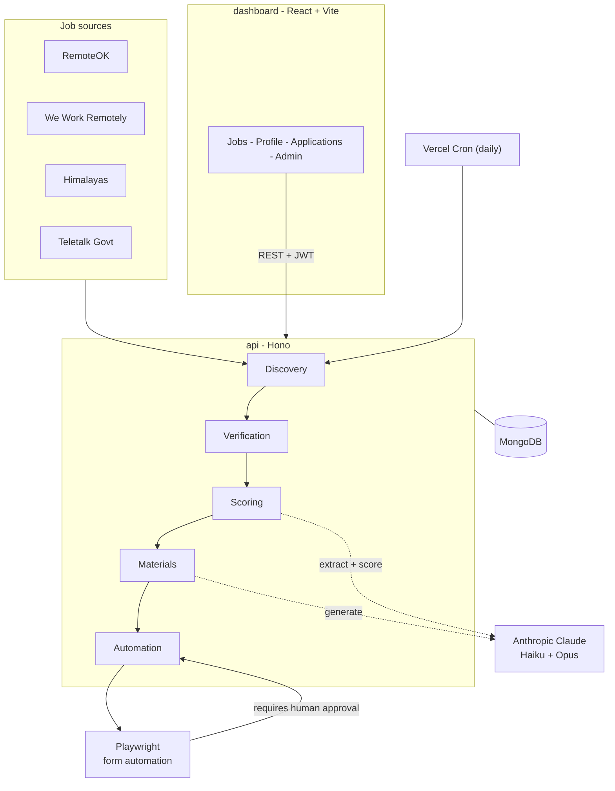

# TalentRadar

> An AI-assisted remote job–hunting platform that **discovers, verifies, scores, and helps you apply to** remote and government job listings — with a human-in-the-loop dashboard for managing your entire search.

TalentRadar crawls multiple job boards, de-duplicates and verifies that each posting is still live, uses Claude to score how well each role fits *your* profile, generates tailored application materials, and can even drive a browser to pre-fill application forms — always stopping for your approval before anything is submitted.

---

## ✨ Features

- **Multi-source job discovery** — pulls listings from RemoteOK, We Work Remotely, Himalayas, and Bangladesh government jobs (Teletalk / alljobs.teletalk.com.bd), with per-host rate limiting and polite fetching.
- **Smart de-duplication** — collapses the same job seen across sources by job ID, normalized URL, and company + title within a 60-day window.
- **Liveness verification** — re-fetches each posting and classifies it as `verified` / `rejected` / `inconclusive` using HTTP status + evidence-pattern matching ("apply now" vs. "no longer accepting applications").
- **AI fit scoring (0–100)** — Claude extracts structured requirements from each description, then a deterministic calculator scores five factors: work-authorization fit, remote fit, salary fit, skill match, and location fit.
- **AI-generated application materials** — tailored CV, cover letter, and outreach message generated with Claude, exportable to **PDF** and **DOCX**.
- **CV upload & parsing** — upload a PDF/DOCX résumé; it's parsed to text and structured into a résumé schema by Claude.
- **Human-gated application automation** — a Playwright engine discovers and fills application forms, detects captchas/login walls, and **requires explicit human approval before submitting**.
- **Cost-controlled AI** — every paid Claude call is checked against configurable daily/monthly USD budgets, with a usage ledger stored per day/month.
- **Rich dashboard** — browse/search/filter jobs, view match breakdowns, manage a profile & résumé, track applications, and (for admins) monitor discovery.
- **Government-jobs support** — Bangladesh govt postings are ingested with structured details (vacancy, age limits, deadlines, advertisement PDF) and skip the verify/score pipeline.

---

## 🏗️ Architecture

### System design



TalentRadar is an **npm workspaces monorepo** with three packages:

| Package | Stack | Responsibility |
|---|---|---|
| **`shared`** | TypeScript, Zod | Single source of truth for schemas & types (auth, job, profile, materials, applications) shared by API and dashboard. |
| **`api`** | [Hono](https://hono.dev) + MongoDB | HTTP API: auth, profiles, discovery, verification, scoring, materials, applications, and Playwright automation. |
| **`dashboard`** | React 18 + Vite 5 + Tailwind v4 | Single-page app for browsing jobs and managing your search. |

### The pipeline

```
Discover ──▶ Verify ──▶ Score ──▶ Generate materials ──▶ Create application ──▶ Automated form-fill ──▶ 🧑 Human approval ──▶ Submit
 (API/RSS,    (HTTP +    (Claude     (Claude Opus)          (DB record)          (Playwright)            (mandatory gate)
  deduped)    evidence)  Haiku +
                         calculator)
```

> Government (Teletalk) jobs are ingested with structured details and **skip** the verify/score steps.

### Tech highlights

- **API:** Hono 4, MongoDB 6, `@anthropic-ai/sdk`, Playwright (Chromium), `fast-xml-parser` (RSS), `pdfkit` / `docx` (exports), `pdfjs-dist` / `mammoth` (CV parsing).
- **Auth:** HS256 JWT (7-day TTL, `hono/jwt`); passwords hashed with **PBKDF2 (WebCrypto, SHA-256, 100k iterations)** — no external auth library.
- **AI:** Claude **Haiku 4.5** for requirements/résumé extraction, Claude **Opus 4.8** for materials generation; prompt-injection-hardened system prompts treat all scraped text as untrusted data.
- **Dashboard:** React Router 6, Tailwind v4 (CSS-first with design tokens + light/dark theme), Base UI + shadcn-style primitives, GSAP animations, DOMPurify-sanitized job HTML. State via React Context (no Redux/Zustand).
- **Testing:** Vitest across every module, with `mongodb-memory-server` for DB-backed tests.
- **CI:** GitHub Actions — typecheck + build + test on Node 22 (with Playwright Chromium).

---

## 🚀 Getting started

### Prerequisites

- **Node.js 22** (see `.nvmrc`)
- **Docker** (for a local MongoDB) — or an existing MongoDB instance

### 1. Install

```bash
npm install
```

### 2. Start MongoDB

```bash
docker compose up -d mongo
```

### 3. Configure environment

Copy the example env and fill it in:

```bash
cp api/.env.example api/.env
```

**API environment variables:**

| Variable | Required | Default | Description |
|---|---|---|---|
| `MONGODB_URI` | ✅ | — | MongoDB connection string |
| `MONGODB_DB_NAME` | | `job_hunter` | Database name |
| `JWT_SECRET` | ✅ | — | Secret for signing JWTs |
| `CRON_SECRET` | ✅ | — | Bearer token guarding the discovery cron endpoint |
| `PORT` | | `8787` | API port |
| `DASHBOARD_URL` | | — | Comma-separated allowed CORS origins |
| `ANTHROPIC_API_KEY` | | — | Enables scoring & materials (routes are disabled if unset) |
| `ANTHROPIC_DAILY_BUDGET_USD` | | `1` | Daily AI spend cap |
| `ANTHROPIC_MONTHLY_BUDGET_USD` | | `20` | Monthly AI spend cap |

**Dashboard environment variables:**

| Variable | Default | Description |
|---|---|---|
| `VITE_API_BASE_URL` | `http://localhost:8787` | Base URL of the API |

### 4. Run everything

```bash
npm run dev
```

- API → http://localhost:8787
- Dashboard → http://localhost:5173

### Other scripts

```bash
npm test         # run all workspace tests (Vitest)
npm run build    # build all workspaces
npm run typecheck
```

---

## 📡 API overview

| Area | Endpoint(s) | Auth |
|---|---|---|
| **Auth** | `POST /auth/register`, `POST /auth/login` | Public |
| **Profile** | `GET/PUT /profile`, `GET /profile/cv/export`, `POST /profile/cv` | JWT |
| **Jobs** | `GET /jobs` (filters: status, source, category, keyword, location, company, salary range, date), `GET /jobs/:id` | Public |
| **Public summary** | `GET /public/jobs-summary` | Public |
| **Discovery** | `POST /discovery/run` | JWT |
| **Verification** | `POST /verification/run` | JWT |
| **Scoring** | `POST /scoring/run` | JWT (AI) |
| **Materials** | `POST /materials/:jobId/generate`, `GET /materials/:jobId`, `GET /materials/:jobId/:version/export` | JWT (AI) |
| **Applications** | `GET/POST /applications`, `GET /applications/:jobId`, `POST /applications/:jobId/runs/:runNumber/approve` | JWT |
| **Automation** | `POST /automation/:jobId/run`, `POST /automation/:jobId/runs/:runNumber/submit` | JWT |
| **Admin** | `GET /admin/users`, `GET /admin/discovery/status` | JWT (admin) |
| **Cron** | `GET /cron/discovery` | `CRON_SECRET` |

---

## 🗄️ Data (MongoDB collections)

`profiles`, `jobs`, `aiUsage`, `materials`, `applications`, `automationRuns`, `approvals`, `auditLog` — with unique indexes guarding job identity (`sourceId + sourceJobId`, `normalizedUrl`) and run/approval records.

---

## ☁️ Deployment

Deployed on **Vercel**:

- **Dashboard** — static SPA build (root `vercel.json`).
- **API** — serverless `fetch` handler (`api/vercel.json`), with a **daily discovery cron** (`GET /cron/discovery`, `0 0 * * *`).

A `Dockerfile` and `docker-compose.yml` are also provided for local development and self-hosting.

---

## 📚 Documentation

- [`docs/ARCHITECTURE.md`](docs/ARCHITECTURE.md) — system design, domain model, and request flows.
- [`docs/SETUP.md`](docs/SETUP.md) — detailed local setup.

---

## 🔒 Security notes

- PBKDF2/WebCrypto password hashing; HS256 JWTs with a 7-day lifetime.
- Scraped job text is treated as untrusted input; AI system prompts are hardened against prompt injection.
- Rendered job descriptions are sanitized with DOMPurify.
- Application **submission always requires explicit human approval** — the automation engine never submits on its own.

---

## 📄 License

See the repository for license details.
